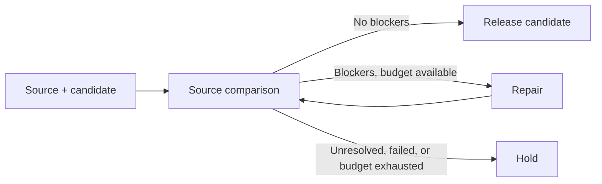

# Source comparison in the text conductor

A complete proposal → critique → revision handoff can still carry forward a mistaken endorsement. In the first text-memory pilot, optional name introductions and a preparation role survived even though the source constrained name collection and extra help. A source check now owns the decision to expose a candidate as the workflow result.

The runtime is `conductor.TextConductor`. It can import a completed, fresh text-memory revision with `begin_from_text_memory`, or accept an explicitly supplied source/candidate pair with `begin`. Import pins the upstream artifact references and event head; later upstream edits require a new source-check episode. The existing structured arithmetic `Conductor` and the baseline text pilot retain their previous contracts.



## What the controller owns

- The immutable source, host policy, role scopes, limits, and call reservations.
- Complete coverage: every source unit and every candidate unit must occur exactly once in the comparison. Unknown IDs, duplicates, omitted rows, and a model-supplied verdict are rejected.
- The gate: a protected source unit must be assessed as preserved. Unknown origin, conflicting additions, and uncertain compatibility block release.
- Repair routing: a repair declaration is not enough. A repaired candidate always goes through another source comparison before release.
- The final state: `released_candidate` or `held`. A held report has no `result_text`. Both remain `semantic_status=unassessed`.

The model supplies semantic judgments. The controller does **not** prove that they are correct. Complete row coverage can still miss a clause inside a unit; source units follow the existing Japanese punctuation rule, while candidate units are nonempty lines. An assessor that incorrectly labels all rows as preserved/compatible can still produce a bad candidate that passes this gate. Evaluate that detector separately from the control mechanism.

## Policy and permissible additions

`SourcePolicy()` uses `mode="preserve"` and protects all source units. This is the conservative default for constrained or ambiguous tasks. No automatic task classifier is shipped. A model's classification or response cannot lower the policy.

For exploration, a trusted caller can select `SourcePolicy(mode="explore", protected_source_ids=("M02", "M07"))`. Changes or omissions of unprotected source units are then permissible. The auditor still assesses compatibility with the selected protected conditions. An empty tuple in explore mode means the caller intentionally protects no source units.

Origin and compatibility are separate axes:

| Origin | Meaning |
|---|---|
| source | Supported by the original source |
| proposal | Introduced in the candidate |
| mixed | A unit combines source content and additions |
| unknown | Origin cannot be determined; blocks release |

A compatible proposal is allowed even in preserve mode. Optional activities are still additions; optionality does not make them source retention. Compatibility is `compatible`, `conflict`, or `uncertain`. Source coverage is `preserved`, `changed`, `omitted`, or `uncertain`. Reference existence is checked by host code; whether it supports the meaning is a model assessment.

## Independent context for comparison

The source auditor receives only the frozen original, the current candidate, and the host policy. It receives neither the previous critique, the nine-component teacher, nor earlier adoption reasons. This reduces direct anchoring on endorsements; it does not establish statistical independence between models. The repairer receives the source, current candidate, policy, and comparison. Neither role can publish the terminal outcome or change the policy.

Every repair must address, hold, or dispute each blocker and cite real units for an addressed item. These declarations are preserved in a repair trace and never resolve the gate by themselves. Subsequent checks always compare the new candidate against the same original.

## Durable bounded control

Default bounds are one repair and three call attempts: compare → repair → compare. Up to two repairs and five calls can be configured explicitly. Each call is reserved in SQLite before invoking a worker; errors and interruptions consume that reservation. An unresolved reservation blocks redispatch after restart. `hold_pending()` explicitly closes it; the runtime never retries a hidden in-flight request.

Each round has distinct candidate/check/repair-trace slots, preserving history without cyclic dependencies. Candidate and repair trace commit atomically. An exhausted call budget cannot release a repaired candidate that has not been rechecked. Source/policy edits and stale replies fail closed. The host is trusted Python code; these scopes are not an operating-system sandbox.

Worker callbacks receive `SourceRequest.timeout_s` and must enforce transport timeouts. The controller discards synchronous replies returned after that interval. It cannot forcibly kill a callback that ignores the timeout. The sample HTTP adapter caps output at 8,192 tokens per call and performs no automatic transport retries.

## Use with an existing text episode

```python
from pathlib import Path
from conductor import SourcePolicy, TextConductor
from conductor.text_workflow import open_text_memory

with open_text_memory(Path("previous/tool_shelf/memory.sqlite"), "tool_shelf") as previous:
    with TextConductor(Path("checked.sqlite"), "checked", SourcePolicy()) as controller:
        controller.begin_from_text_memory(previous)
        # worker(request) returns schema-conforming JSON text and honors timeout_s.
        report = controller.run(worker)
        # Only this field is a released result. A held candidate remains in history.
        result = report["result_text"]
```

`request()` and `submit()` expose the same state machine for external dispatchers. Their caller is responsible for transport deadlines and for explicitly closing interrupted reservations. The controller validates the immutable payload hash, current memory revision, role, and one-use reservation on submission.

## Reproducible mechanism pilot

The fixture contains the actual synthetic tool-shelf candidate from the earlier live run. Its comparison annotations and repaired text are **manually authored**, labeled mechanism fixtures. They are not live detections, ground-truth labels, or task-specific teachers passed to live models.

```bash
python3 -I -S -B experiments/source_alignment_pilot.py --out runs/source-check
python3 -I -S -B experiments/source_alignment_pilot.py --mode replay --replay runs/source-check --out runs/source-check-replay
```

The default fixture supplies five blocking IDs (M02, M07, M08, C14, C20), a repair, then a clear comparison. The runtime releases the repaired candidate after three simulated calls. The `--scenario unresolved` variant declares a repair but leaves the candidate unchanged; another blocked comparison makes the runtime hold it after three calls (CLI exit 1). Both paths replay exactly, with zero API calls.

An explicit live invocation can import a sealed previous text-pilot case:

```bash
python3 -I -S -B experiments/source_alignment_pilot.py --mode live --credentials-from-zshrc --checkpoint previous/tool_shelf --out runs/source-check-live
```

This is a separately budgeted run, at most three new calls under the default policy: Gemini compares, OpenAI repairs if necessary, Gemini rechecks. Only the controller's bounded packet is sent; the fixture's manual annotations are never included. Live provider success, semantic detection quality, and causal improvement must be reported separately from scripted routing success.
